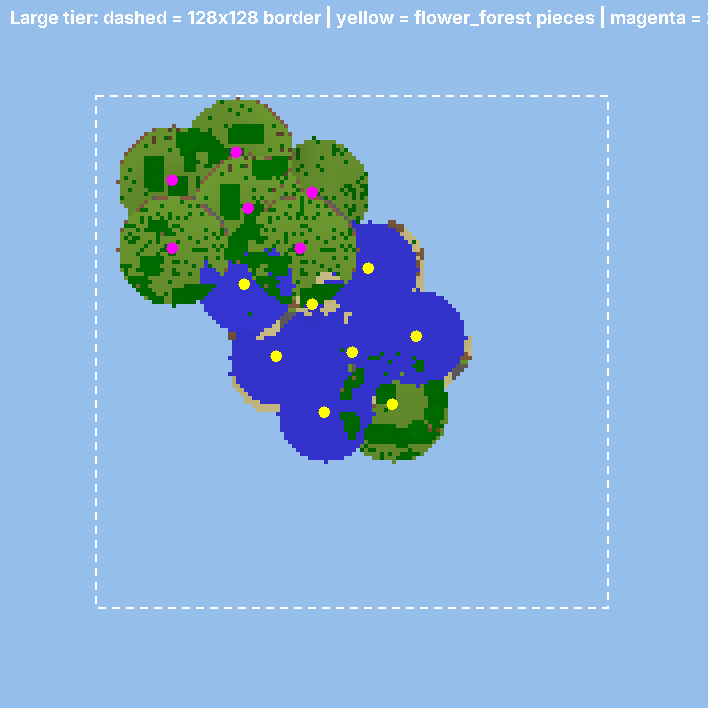

# SkyRealms

A Paper 26.3 plugin: players **buy a floating island**, pick a biome, and **grow it outward**
by attaching more land: more of a biome they own, or whole new biome regions. Jumping off
the edge drops them into the overworld, landing roughly under their island.



## Build

Requires JDK 25.

```bash
./gradlew build
```

The jar is `build/libs/SkyRealms-0.3.0.jar`. Drop it in `plugins/`.

Optional: **Vault** plus an economy plugin. Without one, everything is free, which is handy for testing.
Set `economy.require-vault: true` to block purchases until an economy exists.

## How it works

### 1. Admins capture biome pieces

Islands are built from **pieces**: spheres of real terrain you grab from your own worlds.

1. Go to a nice spot in a biome (say a cherry grove) and stand in the middle.
2. `/skylandadmin preview 16` shows the sphere outline.
3. `/skylandadmin capture cherry_grove 16` saves it as `plugins/SkyRealms/pieces/cherry_grove/cherry_grove_1.skyp`.
4. Do this 4–5 times per biome in different spots. Each one becomes a random variant.

Every folder with at least one piece is a biome players can pick.

Tips:
- Only non-air blocks are saved, so pieces overlap and merge cleanly.
- Water and lava on the outer 2-block shell are skipped so they don't pour off the island forever.
- The real biome is saved per block, so grass colour, sky, fog and music match.
- Radius 12–20 works well. A Small island is 32 wide, so its first piece needs radius ≤ 16.
- Pieces are pasted with a random rotation and a little height jitter so repeats don't look copied.

### 2. Players: everything is in `/skyland`

`/skyland` (aliases `/sl`, `/realm`) opens a chest menu. There are no player subcommands and
no items to lose. Every action is a single tap, so it works the same for Bedrock players
through Geyser/Floodgate. Anything that costs money shows a **Yes/No confirm screen**.

```
/skyland
├── Return to Island            (shows "Buy an Island" if you don't have one)
│   ├── Return to My Island     gust of wind → home (cooldown)
│   ├── Friends' Islands        islands where you're a friend
│   └── Visit Islands           every island open to visitors
├── Manage Island
│   ├── Grow Land               pick an owned biome → confirm
│   ├── Unlock a Biome          pick a new biome → confirm (attaches at the edge)
│   ├── Upgrade                 next size tier → confirm
│   ├── Protection              Visitors / Friends / Island settings
│   ├── Friends                 tap a head to remove; "Add a friend" picks from online players
│   ├── Set Home Here
│   └── (island info)
└── Delete Island               two confirm screens, then the island is wiped
```

Buying: Buy an Island → size → biome → confirm. The size screen also has a "Visit Islands"
button so people can look around first.

Growth rules: each new piece overlaps existing land so the island stays one continuous mass.
Pieces of the same biome cluster together, new biome regions go on the rim, and nothing
grows past the tier's border. When an island is full, players must upgrade.

### 3. Island protection

Owners choose what **Visitors** (everyone) and **Friends** can do, each toggled separately in
the menu (Manage Island → Protection → Visitors / Friends). Owners can always do everything.

| Option | Visitors default | Friends default |
|---|---|---|
| Doors, trapdoors, fence gates | ✅ | ✅ |
| Break blocks / place blocks | ❌ | ✅ |
| Harvest grown crops (and replant) | ❌ | ✅ |
| Buttons, levers, pressure plates | ❌ | ✅ |
| Chests, barrels, shulkers, hoppers | ❌ | ✅ |
| Furnaces, smokers, blast furnaces | ❌ | ✅ |
| Workstations (crafting, anvil, enchanting, brewing) | ❌ | ✅ |
| Redstone tweaks, beds, buckets | ❌ | ✅ |
| Animals (hurt, breed, shear, leash), villager trading, riding | ❌ | ✅ |
| Item frames, armor stands, paintings | ❌ | ✅ |
| Other blocks (cake, pots, signs, composters, ...) | ❌ | ✅ |
| **Trample farmland** | ❌ | ❌ |

Each screen also has **Allow everything**, **Block everything** and **Reset to default** buttons.

Harvesting is separate from breaking, so friends can farm for you without being able to
tear up your build. Replanting seeds counts as harvesting, not placing.

**Island settings** (whole island): Open to visitors (on), PvP (off), Explosion damage (off),
Fire spread (off), Mob griefing: trampling, endermen, etc. (off).

Monsters can always be fought. Ender chests are always usable, since they're personal storage.

### 4. Falling to the overworld

- Falling below `transit.depart-y` in the sky world teleports you to `arrive-y` above the overworld.
- You land at the **same X/Z you jumped from**, plus a random offset of up to `max-landing-offset`
  (200) blocks in any direction. `landing-closeness-bias` makes nearby landings more common
  than far ones.
- Your sideways momentum is kept, so you keep falling instead of hovering.
- The landing that ends the fall takes **no fall damage**. Protection ends once you're on the
  ground (or after `protection-seconds`), so it can't be exploited.
- Landing spots on lava, fire, cactus, magma and similar blocks are re-rolled.
- **Elytra works naturally**: deploy it during the fall and glide wherever you like.

### 5. Going back up

`/skyland` → Return to Island → Return to My Island. A gust of wind throws you upward, then
carries you home a second later. Launch strength, delay and cooldown are set in `config.yml`
(`return:` and `transit.home-cooldown`).

### 6. Deleting an island

`/skyland` → Delete Island, then two confirmations. Anyone standing on the island is sent to
overworld spawn. Every block and entity in the island's area is wiped in the background
(chunk by chunk, no lag spike), and the player can buy a new island right away.
`prices.delete-refund-percent` controls how much of the tier price comes back (default 0).

Island centres sit `islands.spacing` (2048) blocks apart, so each player's landing zone on
the ground is their own area too.

### Admin

`/skylandadmin capture | preview | pieces | give <player> <tier> <biome> | tp <player> | rebuild <player> | reload` (alias `/sla`)

Permissions: `skyrealms.admin` (op), `skyrealms.admin.bypass` (build anywhere in the sky world).

### Multiverse

Not required: the plugin creates the void sky world itself. If you'd rather have Multiverse
manage it, create it with generator `SkyRealms`:

```
/mv create skyrealms_sky normal -g SkyRealms
```

## Config

See `config.yml`: tier footprints, prices and piece counts, biome unlock prices, paste speed,
and transit settings.

## Not built yet (next steps)

- Native Bedrock forms through the Floodgate API (chest menus already work)
- Deleting or resetting an island and clearing its blocks
- Saving chest or sign contents in captured pieces (terrain blocks only)
- An island-wide biome map or per-region claim flags
