<p align="center">
  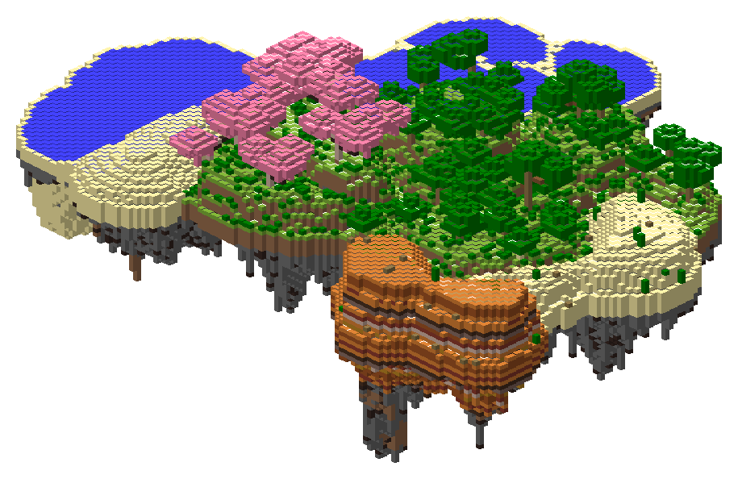
</p>

<h1 align="center">SkyLands</h1>

<p align="center">
  <strong>Buy your own floating island. Grow it biome by biome. Jump off the edge to fall back to Earth.</strong>
</p>

<p align="center">
  
  
  
  
  
  
  <a href="LICENSE"></a>
</p>

<p align="center">
  <a href="https://greyhammond.github.io/SkyLands/"><strong>Website</strong></a> ·
  <a href="https://github.com/GreyHammond/SkyLands/raw/main/docs/skylands.jar"><strong>Download skylands.jar</strong></a> ·
  <a href="#installation">Installation</a> ·
  <a href="#player-guide">Player guide</a> ·
  <a href="#admin-guide">Admin guide</a> ·
  <a href="#configuration">Configuration</a>
</p>

---

**SkyLands** is a Paper plugin for floating-island survival. Every player can buy a personal
island in its own sky world, grow it outward one biome at a time, level it up, and customise how
it looks. The island floats above your normal survival world: step off the edge and you fall out
of the sky, landing below your island.

Down below, **the corruption** waits. Wherever players linger in the overworld, the land slowly
dies: it dries out, turns to wasteland, and finally hardens into bedrock. The overworld is
**recycled every week** to contain it, so the islands in the sky are the only home that lasts.
Players earn money from what they bring back: Void Shards, the remnants of corrupted mobs, and
daily contracts.

It works **out of the box**: islands are generated by the plugin in 19 biomes, with no schematics
or terrain setup. Everything players do happens in one menu, `/skyland`, which shows **chest menus
on Java** and **native Bedrock forms** for players joining through Geyser + Floodgate.

> The plugin's internal name is `SkyRealms` (its data folder is `plugins/SkyRealms/`).

## Table of contents

- [Highlights](#highlights)
- [Screenshots](#screenshots)
- [Requirements](#requirements)
- [Installation](#installation)
- [Player guide](#player-guide)
  - [The `/skyland` menu](#the-skyland-menu)
  - [Island sizes](#island-sizes)
  - [Biomes](#biomes)
  - [Underside styles](#underside-styles)
  - [Island levels](#island-levels)
  - [Cosmetics and themes](#cosmetics-and-themes)
  - [Roles and protection](#roles-and-protection)
  - [Falling and returning](#falling-and-returning)
  - [The corruption](#the-corruption)
  - [Earning money](#earning-money)
- [Bedrock players](#bedrock-players)
- [Admin guide](#admin-guide)
  - [Commands](#commands)
  - [Permissions](#permissions)
  - [Auto-prune and restore](#auto-prune-and-restore)
  - [Custom biomes (optional)](#custom-biomes-optional)
  - [Setting up the corruption](#setting-up-the-corruption)
- [Configuration](#configuration)
- [How it works](#how-it-works)
- [FAQ](#faq)
- [Building from source](#building-from-source)
- [Changelog](#changelog)
- [Support](#support)
- [License](#license)

## Highlights

| | |
|---|---|
| 🏝️ **Buy and grow** | Five island sizes, from Small (32×32) to Continental (512×512). New land attaches to the island's edge, so it stays one connected landmass. |
| 🌸 **19 generated biomes** | Plains to Volcanic, each with its own ground, vanilla trees and plants, and the real biome tag. No setup needed. |
| 🌊 **One sea level** | All ocean, shore and swamp water sits at the same height, held in on every side, so it never floods the void. |
| 🪂 **Fall to Earth** | Step off the edge to land below your island in your survival world. The landing does no damage. |
| ⭐ **Island levels 1–100** | XP for growing, building, farming and visitors. Levels unlock biomes, underside styles, cosmetics and titles. |
| 🎨 **Cosmetics and themes** | Island names, ambient particles, glowing borders, floating islets, and one-tap themes. |
| 🛡️ **Owner-controlled protection** | Separate settings for visitors and friends, from doors and chests to crop harvesting and farmland trampling. |
| 👥 **Co-owners and transfers** | Share an island with co-owners, or hand it to someone else entirely. |
| 📱 **Native Bedrock forms** | Bedrock players get big buttons, toggles and text boxes through Floodgate; Java players get chest menus. |
| 🗄️ **Safe auto-prune** | Inactive islands are archived (chests and all) and can be restored to the same spot within 14 days. |
| ☠️ **The corruption** | Players' presence slowly corrupts the overworld around them: drying, wasteland, then bedrock. The skylands are never touched. |
| ♻️ **Weekly recycle** | A fresh overworld every 7 days (or on command), with countdown warnings and everyone flown home first. |
| 🧪 **Resist it** | Brew Cleansing Tonics from corrupted ingredients (up to 3 minutes of no corruption) and smith Warded armor like a trim (up to 80% less corruption). |
| 💎 **Earn from it** | Void Shards from corrupted land, tougher corrupted mobs that drop Remnants, a Void Exchange to sell them, and daily contracts. |
| 🪙 **Visitor tips** | Visiting an island pays the owner and the visitor a small tip, with daily limits. |
| 💰 **Money or items** | Any Vault economy, or prices in diamonds or a custom token. |

## Screenshots

> These are renders of real islands generated by the plugin on a Paper 26.3 test server,
> drawn from the block data.

**One island growing from a Small oak forest to a Large multi-biome island:**

<p align="center">
  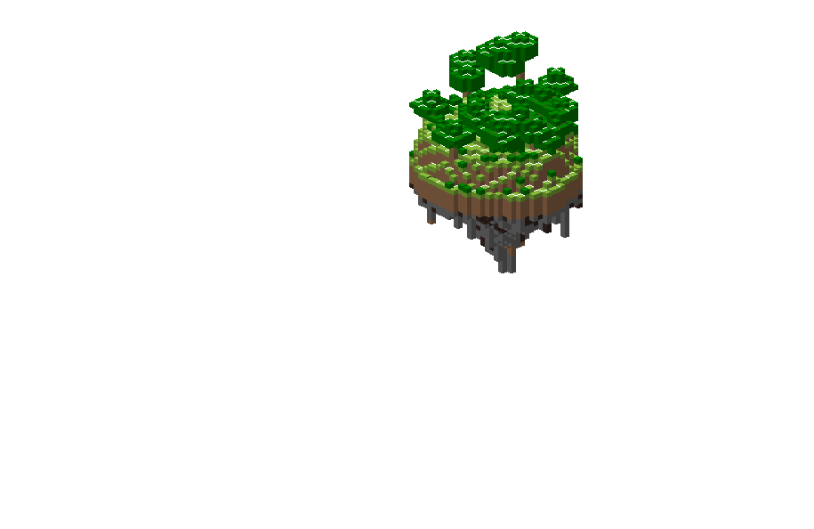
  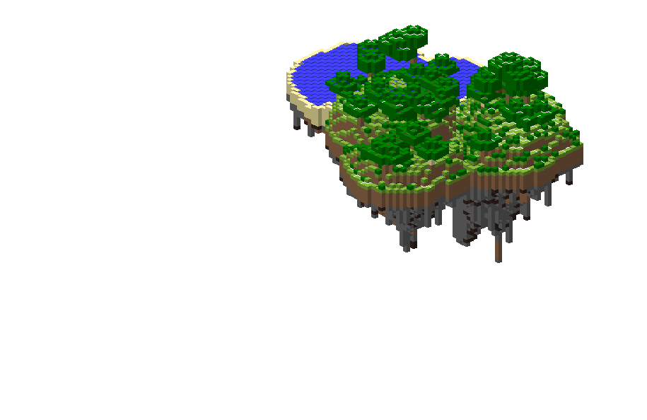
  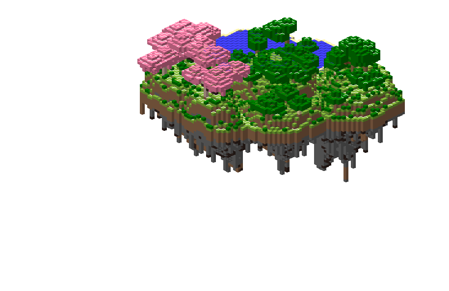
  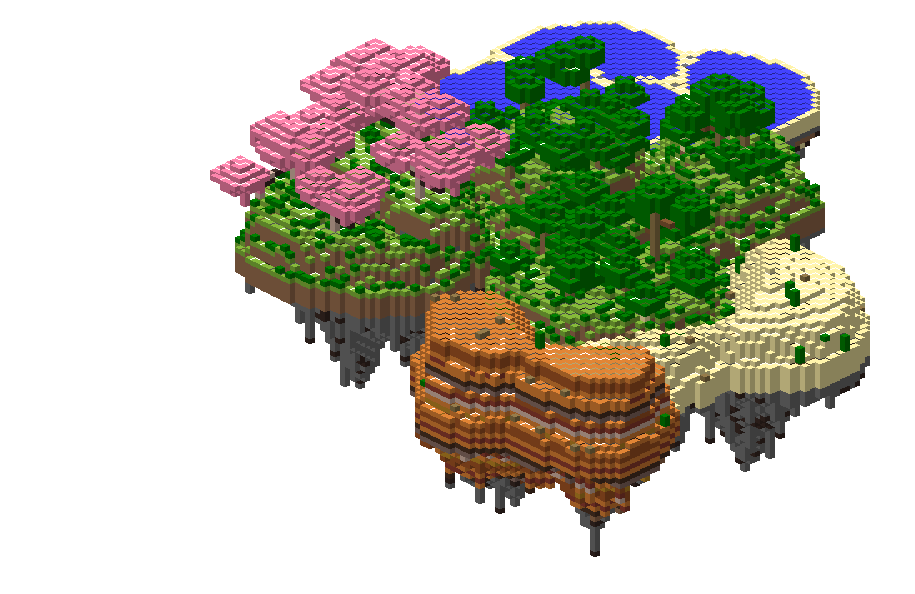
  
</p>

**Biomes with underside styles:**

| Snowy · Ice | Mushroom Fields · Roots | Lush Caverns · Lush |
|:---:|:---:|:---:|
| 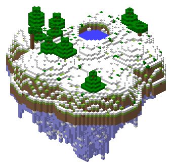 | 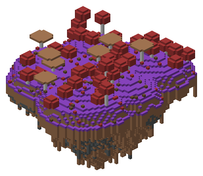 | 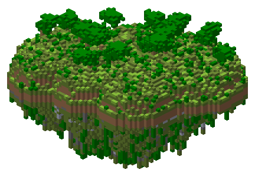 |
| **Volcanic · Nether** | **Crystal · Crystal** | **Ancient Ruins · Ruins** |
| 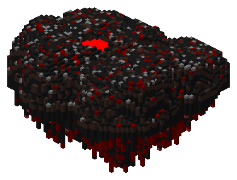 | 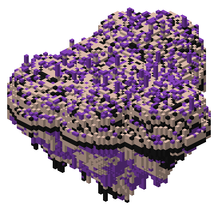 | 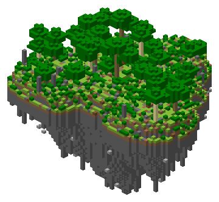 |

**Side view: rounded top, rocky spikes underneath.**

<p align="center">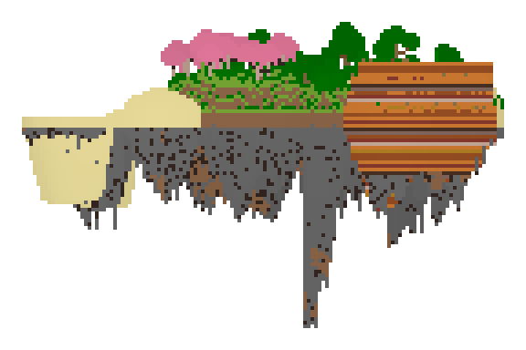</p>

## Requirements

| | Version | Required? |
|---|---|---|
| [Paper](https://papermc.io/) | 26.3 | **Required** |
| Java | 25 | **Required** |
| [Vault](https://www.spigotmc.org/resources/vault.34315/) + an economy plugin | any | Optional. Without it (and without item currency) islands are free. |
| [Geyser](https://geysermc.org/) + Floodgate | Floodgate 2.2.x | Optional. Enables native Bedrock forms. |
| [LuckPerms](https://luckperms.net/) | any | Optional. Any Bukkit permissions plugin works. |
| Multiverse-Core | any | Optional. The plugin creates its own sky world. |

## Installation

1. Download [`skylands.jar`](https://github.com/GreyHammond/SkyLands/raw/main/docs/skylands.jar) (the latest build, stored in [`docs/`](docs/)).
2. Put it in your server's `plugins/` folder.
3. Start the server. SkyLands creates an empty void world called `skyrealms_sky`, plus
   `plugins/SkyRealms/config.yml` and `levels.yml`.
4. Check `worlds.overworld` in `config.yml` matches your main world (default `world`).
5. Players type **`/skyland`**. That's it.
6. *Optional, recommended:* turn on [the corruption](#setting-up-the-corruption) with
   `decay.enabled: true` and `recycle.enabled: true`, then restart.

## Player guide

### The `/skyland` menu

Everything is in one menu (aliases `/sl`, `/realm`). Anything that costs money asks you to confirm.

**`/ihome`** flies you to your island home on a gust of wind, just like Return to Island (named so it never clashes with Essentials'
`/home`). `/ihome set` moves your home to where you're standing; `/ihome reset` clears it.
Until you set a home, you always arrive on **dry, solid ground** near your island's centre, never
in a pond or on a tree.

```
/skyland
├── Return to Island            "Buy an Island" if you don't have one
│   ├── Return to My Island     a gust of wind carries you home
│   ├── Friends' Islands        islands where you're a friend
│   ├── Visit Islands           every island open to visitors
│   └── Top Islands             ranked by level, then visits
├── Manage Island
│   ├── Island Level            XP bar, next unlock, all levels & unlocks
│   ├── Grow Land               add land of any biome you own, and choose where it goes
│   ├── Unlock a Biome          make a new biome available in Grow Land
│   ├── Upgrade                 more room: bigger border, higher piece cap
│   ├── Underside Style         what hangs under new land
│   ├── Cosmetics & Themes      name, particles, border, islets, themes
│   ├── Protection              Visitors · Friends · Island settings
│   ├── Friends                 add from online players
│   ├── Set Home Here
│   ├── Co-owners               owner only
│   └── Transfer Island         owner only
└── Delete Island               owner only, two confirmations
    Leave Island                what co-owners see instead
    Restore My Island           appears if your island was archived
    Hotbar Shortcuts            turn the menu book and return feather on or off
└── The Corruption              corruption where you stand
    ├── Void Exchange           sell Void Shards and Corrupted Remnants
    ├── Recipes                 Warded armor and Cleansing Tonics
    └── Daily Contracts         three tasks a day for money and shards
```

**Hotbar shortcuts:** an enchanted **Skyland Menu** book (slot 9) and an enchanted **Return to
Island** feather (slot 8) can sit in your hotbar, so you never need a command. Use the book to open
the menu and the feather to fly home; tapping either one in your inventory works too. They're
locked in place: they can't be dropped, thrown, moved, put in chests or item frames, or lost when
you die (they're back after you respawn). Turn them on or off with **Hotbar Shortcuts** in the
`/skyland` menu. By default Bedrock players start with them on and Java players with them off.

**Buying:** Buy an Island → size → biome → **style** → confirm. New islands start at level 1, so
only level 1 biomes can be picked. Shallow and Deep Ocean can only be added later.

**Style your new island:** if you've unlocked underside styles or themes before (your level is
saved when you delete an island), you can pick one before the land is made: keep your saved style,
choose any unlocked underside, or choose a theme (underside, particles and border in one). The
starting land is built in that style from the first block. Players with nothing unlocked yet skip
this step.

**Growing:** unlock a biome, then use **Grow Land** and choose **where it goes**:

- **Automatic**: the island picks a good spot (a new biome starts at the edge; more of a biome
  clusters with it).
- **Toward where I'm standing**: stand at the edge you want, and the land attaches on **your side**
  of the island.
- **A compass direction**: North, North-East, East, … (north is toward −Z). Land only ever goes on
  that side.

If there's no room on the side you asked for, nothing is placed and **you aren't charged**: try
another side, choose Automatic, or upgrade. In Automatic, a first Shallow or Deep Ocean (or beach)
prefers to sit next to your beaches, deserts and swamps.

New land always touches the island and stays inside your border. Oceans grown next to each other
**join into one body of water**, with no sand bars between them.

### Island sizes

| Size | Footprint | Price | Starting land | Max land |
|---|---|---:|---:|---:|
| Small | 32 × 32 | 5,000 | 1 piece | 3 pieces |
| Medium | 64 × 64 | 20,000 | 3 pieces | 10 pieces |
| Large | 128 × 128 | 75,000 | 8 pieces | 30 pieces |
| Extra Large | 256 × 256 | 250,000 | 20 pieces | 90 pieces |
| Continental | 512 × 512 | 1,000,000 | 50 pieces | 300 pieces |

- **Upgrading** costs the difference in price and adds **room, not land**: a bigger border and a
  higher piece cap. You fill it with Grow Land.
- **Grow Land** costs 1,000 per piece. **Unlocking a biome** costs 10,000 by default, and each
  biome can be priced separately.
- All values are configurable.

### Biomes

| Biome | Level | Looks like |
|---|:---:|---|
| Plains | 1 | Gentle grassland with a few oaks |
| Oak Forest | 1 | Dense oak and birch woods |
| Desert | 1 | Sand dunes and cacti |
| Beach | 1 | Sandy shore at sea level |
| Meadow | 5 | Wildflowers everywhere |
| Hilly Plains | 5 | Rolling grassy hills |
| Cherry Grove | 5 | Pink blossoms and petals |
| Shallow Ocean | 5 | Water with seagrass *(expansion only)* |
| Jungle | 15 | Towering jungle trees and bushes |
| Badlands | 15 | Striped terracotta mesas |
| Swamp | 15 | Murky shallows, lily pads, swamp oaks |
| Snowy | 15 | Snow-covered spruce forest, frozen lakes |
| Dark Oak Forest | 30 | Dark canopy and giant mushrooms |
| Deep Ocean | 30 | Deep water and kelp forests *(expansion only)* |
| Mushroom Fields | 30 | Mycelium and giant mushrooms |
| Lush Caverns | 30 | Moss, azaleas, glow berries hanging underneath |
| Volcanic | 50 | Basalt, tuff and magma with lava lakes |
| Crystal | 50 | Calcite and amethyst with crystal spires |
| Ancient Ruins | 50 | Mossy ground, broken stone-brick pillars |

### Underside styles

Choose what hangs under your island in **Manage Island → Underside Style**. Pick:

- **New land only** (free): land you grow from now on hangs the new style.
- **Convert my whole island** (2,500 by default): also reshapes the rock under the land you already
  have. Only natural underside rock is changed; your builds, tunnels, soil and surface stay exactly
  as they are. Applying a theme offers the same choice.

| Style | Level | Looks like |
|---|:---:|---|
| Rock | 1 | Classic stone with ores |
| Roots | 10 | Dirt and rooted dirt, roots dangling below |
| Ice | 20 | Packed and blue ice |
| Lush | 30 | Moss with glow-berry vines and spore blossoms |
| Dripstone | 40 | Dripstone with stalactites |
| Crystal | 55 | Amethyst and calcite with hanging crystals |
| Nether | 65 | Blackstone and magma, weeping vines and shroomlights |
| Ruins | 75 | Old stone bricks with lanterns on chains |

### Island levels

Islands earn XP and level up from **1 to 100**. Actions by the owner and co-owners count.

| Action | XP | Daily limit |
|---|---:|---|
| Buy an island | 150 per starting piece | |
| Grow Land | 150 per piece | |
| Unlock a biome | 300 | |
| Upgrade | 500 – 10,000 | |
| Place a block that stays | 1 | 1,500 (breaking takes it back) |
| Harvest a fully grown crop | 2 | 800 |
| Unique visitor | 25 | 500 (once per visitor per day) |

- **Curve:** total XP for level *L* is `25·L² + 75·L` (level 10 = 3,250 · level 50 = 66,250 ·
  level 100 = 257,500). Spending reaches about level 50; the rest takes real play.
- **Titles:** 1 Castaway · 10 Settler · 20 Homesteader · 30 Sky Farmer · 40 Cloud Walker ·
  50 Cloud Baron · 60 Wind Rider · 70 Storm Keeper · 80 Sky Lord · 90 High Sovereign ·
  100 Continental.
- **Shown in** the Manage Island level card, the Levels & Unlocks screen, visit cards,
  **Top Islands**, and a banner when you walk onto an island.
- **Level-ups** show a title and fireworks, with a server-wide announcement every 10 levels.

### Cosmetics and themes

**Manage Island → Cosmetics & Themes.**

| Cosmetic | Options | Unlocks at |
|---|---|---|
| Island name | Java: typed in chat · Bedrock: a text box | Lv 5 |
| Particles | Fireflies · Petals · Snowfall · Embers · Sparkles · Aurora | Lv 10 · 25 · 40 · 60 · 80 · 100 |
| Border style | Basic · Leaves · Glow · Flame (lights up near the edge) | Lv 15 · 30 · 45 · 70 |
| Floating decorations | A Few Islets · Many Islets · Rock Ring | Lv 20 · 50 · 90 |

**Themes** set the underside style (for new land), particles and border in one tap, including
parts you haven't unlocked on their own yet.

| Theme | Level | Underside | Particles | Border |
|---|:---:|---|---|---|
| Frozen | 20 | Ice | Snowfall | Basic |
| Medieval | 35 | Ruins | none | Basic |
| Fantasy | 45 | Lush | Fireflies | Glow |
| Magical | 60 | Crystal | Sparkles | Glow |
| Volcanic | 70 | Nether | Embers | Flame |
| Ancient | 80 | Ruins | Petals | Leaves |

### Roles and protection

| Role | Can |
|---|---|
| **Owner** | Everything, including delete, transfer and managing co-owners |
| **Co-owner** | Grow, unlock, upgrade, change protection, friends and cosmetics; build anywhere. Pays from their own balance. |
| **Friend** | Whatever the Friends settings allow |
| **Visitor** | Whatever the Visitors settings allow |

Default settings (change them in **Manage Island → Protection**):

| Action | Visitors | Friends |
|---|:---:|:---:|
| Doors, trapdoors, fence gates | ✅ | ✅ |
| Break / place blocks | ❌ | ✅ |
| Harvest grown crops (and replant) | ❌ | ✅ |
| Buttons, levers, pressure plates | ❌ | ✅ |
| Chests, barrels, shulkers, hoppers | ❌ | ✅ |
| Furnaces, smokers, blast furnaces | ❌ | ✅ |
| Workstations (crafting, anvil, enchanting, brewing) | ❌ | ✅ |
| Redstone tweaks, beds, buckets | ❌ | ✅ |
| Animals, villager trading, riding | ❌ | ✅ |
| Item frames, armor stands, paintings | ❌ | ✅ |
| Other blocks (cake, pots, signs, composters) | ❌ | ✅ |
| Trample farmland | ❌ | ❌ |

**Island settings:** open to visitors (on) · hostile mob spawning (on) · peaceful mob spawning
(on) · PvP · explosion damage · fire spread · mob griefing (all off).

The two **mob spawning** switches cover the whole island (not plots or areas within it) and only
stop *natural* spawning: spawn eggs, spawners, breeding and anything you bring still work. **Transfer:** the new owner takes over and the old owner immediately becomes a visitor.

### Falling and returning

- Islands float below the clouds (new islands have their sea level at Y 140, clouds are at
  about Y 192), so the sky stays clear above you.
- You can explore and build under your island freely: the fall only hands off to the overworld at
  **Y −40**, far below even the deepest underside.
- Fall past that and you appear high above the overworld at the **same X/Z**, plus a random
  offset of up to 200 blocks. Your momentum is kept and an elytra works mid-fall.
- The landing that ends the fall does no damage; normal falls still hurt. Unsafe spots (lava,
  cactus, magma) are re-rolled.
- **Return to Island** (and `/ihome`) launches you upward on a gust of wind that keeps lifting you
  for a second, then carries you home while you're still rising (with a cooldown). Height and
  timing are set in the `return` section of `config.yml`.
- The rushing wind of a fall stops the moment you touch down.
- With [the weekly recycle](#setting-up-the-corruption) on, you fall into the current recycled
  overworld (`skyrealms_overworld_<n>`), not your main world.

### The corruption

The longer players stay in one part of the overworld, the more it decays. Each chunk (16×16
blocks) has a corruption value from 0 to 100%, shown on your action bar as **Corruption 43%**.

- You corrupt your own chunk and every chunk within **2 chunks** of it at full speed (an
  80-block square), plus **2 fading rings** beyond that (up to 144 blocks across) that can reach 50%.
- Keep moving around one spot and the first changes show after about **13 minutes**; full
  corruption takes about **30**. More players corrupt faster.
- Players who stand still for a minute stop corrupting. Creative players never do.
- Leave an area and its value slowly falls again. **Bedrock never heals**: only the weekly
  recycle removes it.
- Blocks within 3 of a player are never changed, so nobody gets trapped.

| Corruption | What happens |
|---|---|
| 0–25% | Nothing yet, apart from ash in the air |
| 25–50% · **Drying** | It creeps in: leaves and plants die, pools dry into sand and clay beds, ice melts, grass and dirt turn coarse, sandy or stony. Crops and grass stop growing. |
| 50–75% · **Wasteland** | Stone turns to blackstone, deepslate and basalt; logs harden to stone; water boils away or turns to lava; the ground becomes sand, clay and terracotta. The first bedrock appears. |
| 75–100% · **Barren** | Corruption speeds up, bedrock spreads down from the surface, and it spills into neighbouring chunks. |

**Resisting it:** both are made from what the corruption leaves behind. All the recipes are also in
`/skyland` → **The Corruption** → **Recipes**, and in the recipe book.

| Item | Effect |
|---|---|
| Cleansing Tonic I / II / III | You cause no corruption for 60 / 120 / 180 seconds (a boss bar shows the time left). The splash version protects everyone within 4 blocks. |
| Warded armor I / II / III | Each worn piece cuts your corruption by 5% / 10% / 20%. A full level-III set cuts 80%. Trims and enchantments are kept. |

**Warded armor** is smithed like an armor trim, and each level is harder to reach:

| Step | Where | Recipe | Result |
|---|---|---|---|
| 1 | Crafting table | 8 Void Shards around 1 Crying Obsidian | Ward Template |
| 2 | Smithing table | Ward Template + armor piece + Void Shard | Ward I armor |
| 3 | Crafting table | Ward Template surrounded by 8 Corrupted Remnants | Corrupted Template |
| 4 | Smithing table | Corrupted Template + Ward I armor + Corrupted Remnant | Ward II armor |
| 5 | Smithing table | Corrupted Template + Ward II armor + Echo Shard | Ward III armor |

Templates are used up. Echo Shards are the vanilla item found in Ancient City chests in the Deep Dark.

**Cleansing Tonics** are brewed from **corrupted ingredients**, dropped only by corrupted mobs
(spiders, skeletons and creepers drop corrupted versions of their usual drops):

| Brewing stand | Ingredient | Result |
|---|---|---|
| Water Bottle | Void Shard | Tainted Potion |
| Tainted Potion | Corrupted Spider Eye | Cleansing Tonic I |
| Cleansing Tonic I | Corrupted Bone | Cleansing Tonic II |
| Cleansing Tonic II | Corrupted Remnant | Cleansing Tonic III |
| Any Cleansing Tonic | Corrupted Gunpowder | Splash Cleansing Tonic (same level) |

Only the real corrupted items work; vanilla spider eyes, bones and gunpowder don't. Servers that
prefer a shop can set `tonic.shop: true` and `ward.shop: true` to bring back `/skyland tonic buy`
and `/skyland ward upgrade`.

### Earning money

Everything you bring back from the corruption sells at the **Void Exchange**
(`/skyland` → **The Corruption** → **Void Exchange**, or `/skyland exchange`).

| Source | What you get |
|---|---|
| **Corruption harvest** | Breaking natural blocks in corrupted land can drop **Void Shards**: about 1% of blocks when drying, 4% in wasteland, 10% when barren. Blackstone and deepslate drop twice as often, blocks touching bedrock 1.5×. Fresh bedrock sometimes leaves a shard behind. Blocks you placed never count; up to 20 shards a minute. |
| **Corrupted mobs** | Monsters that spawn on corrupted land may become **Corrupted** (15% to 60% of them, by corruption): purple names, +25–75% health, +10–30% damage. They drop 1–4 **Corrupted Remnants**, sometimes shards, and a **corrupted ingredient** for brewing (Spider Eye, Bone, Gunpowder or Flesh), on top of normal drops. |
| **Daily contracts** | Three tasks a day, reset at 4 AM server time: deliver items, hunt mobs or corrupted mobs, mine, explore new chunks, or hand in shards. Rewards are money and shards, **×1.5** in the last 24 hours before a recycle. Hand in part of a delivery whenever you like. |
| **Visitor tips** | Visit someone's island from **Visit Islands** and stay 30 seconds: the owner gets 50 and you get 20 (more for higher-level islands). Once per island per day, up to 5 tips a day as a visitor and 20 as an owner. No tips for your own, a friend's or a co-owned island. |

Default Exchange prices: **Void Shard 25**, **Corrupted Remnant 75**. Void items can't be used in
crafting or anvils, and renamed vanilla items are never accepted.

## Bedrock players

With **Floodgate** installed, Bedrock players automatically get **native Bedrock forms**; Java
players keep chest menus. Both use the same actions, so prices, levels, permissions and limits are
identical.

| Screen | Java | Bedrock |
|---|---|---|
| Menus and lists | Chest menu | Big full-width buttons |
| Buying, delete, transfer | Yes/No chest screen | Yes/no pop-up (two for delete and transfer) |
| Protection | Tap each option | One screen of toggles with a quick-set dropdown |
| Rename island | Type in chat | A real text box |
| The Corruption, Void Exchange, Daily Contracts | Chest menus | Forms with sell, hand-in and claim buttons |

Bedrock players also get the **hotbar shortcuts** (menu book and return feather) by default, so
they can play without typing a single command.

Without Floodgate, everyone gets chest menus and the form code is never loaded.

## Admin guide

### Commands

Players only need `/skyland` (and `/ihome` for a quick trip home). Shortcuts:
`/skyland exchange` and `/skyland contracts`. (`/skyland tonic buy` and `/skyland ward upgrade` only
sell when the shop is turned on in config; otherwise they show the recipes.) Admin commands (`/skylandadmin`, alias `/sla`) all have
**Tab completion**: press Tab to cycle through sizes, tiers, biomes and player names.

| Command | Description |
|---|---|
| `give <player> <size> <biome>` | Create an island for a player, free of charge |
| `tp <owner>` | Teleport to someone's island |
| `rebuild <owner>` | Restore missing terrain (never overwrites builds) |
| `xp <owner> [add\|set <amount>]` | View or change an island's XP |
| `prune preview` | List islands that would be archived for inactivity |
| `prune run` | Archive inactive islands now |
| `prune exempt <owner>` | Toggle: never auto-prune this island |
| `restore <owner>` | Restore an archived island |
| `archives` | List archived islands and days left to restore |
| `pieces` | List built-in and custom biomes |
| `capture <biome> [small\|medium\|large\|huge] [name]` | *Optional:* save terrain around you as a custom biome piece |
| `preview [small\|medium\|large\|huge]` | *Optional:* show the capture sphere |
| `decay [set <0-100>\|clear]` | Show your chunk's corruption, set it, or clear every value (changed blocks stay) |
| `recycle [status\|now [seconds]\|cancel]` | Weekly overworld recycle: status, start the countdown now, or cancel it |
| `tonic give <player> <1-3> [amount]` | Give Cleansing Tonics |
| `ward apply <1-3>` · `ward give <player> <piece> <1-3>` | Ward the armor in your hand, or give a warded iron piece |
| `void give <player> <shard\|remnant> [amount]` | Give Void Shards or Corrupted Remnants |
| `contracts reset <player>` | Give a player a fresh set of contracts |
| `reload` | Reload custom biome pieces (config changes need a restart) |
| `help` | Show the command list in game |

### Permissions

Works with **LuckPerms** or any Bukkit permissions plugin.

| Node | Default | Grants |
|---|---|---|
| `skyrealms.use` | everyone | `/skyland` and everything in the menu |
| `skyrealms.admin` | op | All admin commands, plus every node below |
| `skyrealms.admin.bypass` | op | Build and interact on any island, ignoring protection |
| `skyrealms.bypass.cooldown` | op | No cooldown on Return to Island |
| `skyrealms.bypass.closed` | op | Visit islands that are closed to visitors |

```text
/lp group moderator permission set skyrealms.bypass.closed true
```

### Auto-prune and restore

An island is **inactive** when its owner and every co-owner have been offline for 30 days
(configurable). Every few hours, inactive islands are archived:

- **Saved:** every block, chest and sign contents, entities and all settings, in
  `plugins/SkyRealms/archives/<owner-uuid>/`. The island is then removed from the world.
- **Restore:** within 14 days, the owner sees **Restore My Island** in `/skyland` (and a reminder
  on join), or an admin runs `/skylandadmin restore <owner>`. It returns to the exact same spot.
- **After 14 days** the archive is deleted.
- Use `/skylandadmin prune exempt <owner>` to protect an island. Islands whose owner has never
  joined are skipped.

### Custom biomes (optional)

You can add your own biomes by capturing terrain from your worlds:

1. Stand in a spot you like and run `/skylandadmin preview medium` to see the sphere.
2. `/skylandadmin capture my_biome medium` saves it to `plugins/SkyRealms/pieces/my_biome/`.
3. Capture a few spots for variety. The folder appears as a biome in the menus.

Sizes: `small` (21 wide), `medium` (29), `large` (41), `huge` (57), or a radius from 4 to 48.

### Setting up the corruption

The corruption is **off by default**. To turn it on, set these in `config.yml` and restart:

```yaml
decay:
  enabled: true
recycle:
  enabled: true
```

- The recycle creates a dedicated overworld, `skyrealms_overworld_1`, and falls land there. Your
  main world stays as the spawn world and is **never** corrupted or deleted (Paper can't delete
  the main world anyway).
- Every 7 days (or `/skylandadmin recycle now`) players get countdown warnings at 10 min, 5 min,
  1 min, 30 s and 10 s, are flown home, and a fresh world `skyrealms_overworld_<n+1>` replaces the
  old one. The old world's folder is then deleted, retrying if Windows still has files locked.
- Deletion is guarded: only worlds the plugin created and recorded in `recycle.yml`, never the
  main or sky world, and only real world folders inside the server folder. Paper 26's
  `world/dimensions/minecraft/` layout is supported.
- `/sethome`, `/esethome`, `/createhome` and `/setwarp` are blocked in the recycled world so
  homes can't point at deleted land (`skyrealms.admin.bypass` ignores this).
- To try decay without the recycle, set `decay.allow-main-world: true`. Changes to your main world
  are then permanent.
- To test quickly, raise `decay.gain-per-second` (0.3 is about 10× faster) or use
  `/skylandadmin decay set 30`, `55`, `80`.
- Nether and End portals in the recycled world lead to your normal Nether and End.

## Configuration

SkyLands creates two files in `plugins/SkyRealms/`. Restart the server after editing them.

**`config.yml`**

| Section | Controls |
|---|---|
| `worlds` | The sky world's name and the overworld players fall into |
| `islands` | Island spacing, sea level for new islands (`base-y`, default 140), build speed (blocks per tick) |
| `terrain` | Size range of each piece of land |
| `tiers` | Footprint, price, starting and maximum land for each size |
| `prices` | Grow price, biome unlock prices (per biome), underside restyle price, refund on delete |
| `economy` | `currency: vault` or `item`, plus the item, its value and an optional token name |
| `prune` | Auto-prune on/off, inactive days (30), restore window (14), check interval |
| `transit` | Where the fall hands off (`depart-y`, default −40), landing spread, landing protection, return cooldown |
| `return` | Strength and duration of the Return to Island launch |
| `bedrock` | Native Bedrock forms on/off, form button icons |
| `cosmetics` | Island name length and banned words |
| `hotbar` | Hotbar shortcuts on/off, who has them by default (`bedrock`, `all` or `none`), and their slots |
| `capture-sizes` | Radius of each custom-biome capture size |
| `decay` | Corruption on/off, speed, radius and falloff, stage thresholds, healing, spill, block-change budget |
| `recycle` | Weekly recycle on/off, interval, warning times, messages, blocked commands |
| `tonic` | Cleansing Tonic durations (max 180 s), splash radius, and the optional shop (off by default) |
| `ward` | Warded armor reduction per level, the 80% cap, and the optional shop (off by default) |
| `exchange` | Void Shard and Corrupted Remnant sell prices |
| `harvest` | Shard drop chances per stage, multipliers, per-minute cap |
| `corrupted-mobs` | How often mobs become corrupted, their buffs and drops, an optional coin bounty |
| `tips` | Owner and visitor tips, level scaling, minimum stay, daily caps |
| `contracts` | Contracts per day, reset hour, recycle bonus, and the pool of tasks and rewards |

**`levels.yml`**: XP amounts and daily caps, the level curve, biome, underside and cosmetic
unlock levels, titles, and optional console commands to run when an island reaches a level.

<details>
<summary>Example: pay with diamonds instead of money</summary>

```yaml
economy:
  currency: item
  item:
    material: DIAMOND   # any item
    value: 1000         # 1 diamond per 1,000 of price: a 5,000 island costs 5 diamonds
    name: ""            # optional: only accept items with this display name (custom tokens)
```
</details>

<details>
<summary>Example: reward money at level milestones</summary>

```yaml
rewards:
  10:
    - "eco give {owner} 1000"
  50:
    - "give {owner} diamond 16"
```
</details>

## How it works

- **Sky world:** a void world with islands placed 2,048 blocks apart. Falling off an island lands
  you under its X/Z in your overworld, so each island has its own area on the ground.
- **Terrain:** each island is a cluster of rounded pieces of land. Heights blend between biomes,
  and each piece hangs a tapered rocky spike underneath, with one large central spike.
- **Sea level:** sea water is only placed where all four sides are held in; otherwise that column
  becomes a sand rim. Lakes form only inside land ringed by higher ground.
- **No valleys:** pieces have rounded tops that level out, and when new land grows beside old land,
  the old rim is raised to meet it (only plain natural ground: never a column with a build or a
  tree, and ground is never lowered).
- **Growth never breaks builds:** new land only fills empty space and blends into the existing edge.
  The only existing columns it may rebuild are sand rims at sea level and plain open water (water,
  seagrass and kelp on a natural floor), so neighbouring oceans join seamlessly. Water is only ever
  deepened, never turned into land.
- **Performance:** terrain is planned off the main thread and placed a slice per tick. Particles
  are sent only to players on that island.

**Upgrading from 0.11 or older:** on first start, 0.12 updates an untouched `base-y: 180` to
140 and `depart-y: 100` to −40, and logs it. Each island remembers the height it was built at, so
**existing islands stay exactly where they are** and keep growing at their own height; only islands
bought afterwards are lower. Values you changed yourself are left alone.

## FAQ

<details>
<summary><strong>Does growing or upgrading change land I've built on?</strong></summary>

No. New land only fills empty space. Upgrading only enlarges the border and the piece cap.
</details>

<details>
<summary><strong>Can I choose where new land goes?</strong></summary>

Yes. After picking a biome in Grow Land, choose Automatic, a compass direction, or **Toward where
I'm standing**. The land only goes on the side you chose, touching the island and inside the
border. If there's no room there, nothing is placed and you aren't charged.
</details>

<details>
<summary><strong>If I delete my island, do I lose my level and unlocks?</strong></summary>

No. Your island's XP (and so its level and everything it unlocked), your unlocked biomes, underside
style and cosmetics are saved to you. Your next island starts with all of it, so you can delete a
starter island and rebuild it the way you want. The same happens if an archived island expires.
</details>

<details>
<summary><strong>Can I pick my underside or theme for a brand-new island?</strong></summary>

Yes. When you buy, after choosing the biome, pick any underside style or theme you've unlocked
(your level carries over from a deleted island). The starting land is built in that style.
</details>

<details>
<summary><strong>Why is my old island higher than my friend's new one?</strong></summary>

Islands bought before 0.12 keep the height they were built at, so nothing gets cut in half. New
islands sit lower, under the clouds.
</details>

<details>
<summary><strong>Can I turn off mob spawning?</strong></summary>

Yes, for the whole island: Protection → Island settings → Hostile mob spawning / Peaceful mob
spawning. Spawn eggs, spawners and breeding still work.
</details>

<details>
<summary><strong>Can I change the underside of land I already have?</strong></summary>

Yes: in Underside Style, choose **Convert my whole island**. Only natural underside rock is changed.
</details>

<details>
<summary><strong>Can water or lava flood the void?</strong></summary>

No. All sea water sits at one sea level and is only placed where it's held in on every side.
Lakes (and Volcanic lava lakes) only form where higher ground surrounds them.
</details>

<details>
<summary><strong>Can the corruption reach my island?</strong></summary>

No. It only runs in the overworld players fall into. The sky world is never touched.
</details>

<details>
<summary><strong>What happens to things I build in the overworld?</strong></summary>

They're gone when the overworld is recycled, along with the corruption. Build your home on your
island and treat the overworld as a place to gather.
</details>

<details>
<summary><strong>Does corruption hurt players?</strong></summary>

No. It changes the land and ends in bedrock, but it never damages players.
</details>

<details>
<summary><strong>Do I need Vault?</strong></summary>

No. Without an economy plugin, islands are free (handy for testing). You can also set
`economy.currency: item` to charge diamonds or a custom token.
</details>

<details>
<summary><strong>Do Bedrock players need anything?</strong></summary>

They join through Geyser as usual. If Floodgate is installed, they get native forms automatically.
</details>

<details>
<summary><strong>What happens to an inactive player's island?</strong></summary>

After 30 days it's archived and removed from the world. The owner can restore it, exactly as it
was, for 14 days.
</details>

## Building from source

Requires JDK 25.

```bash
./gradlew build
```

The jar is written to `build/libs/skylands.jar`. The website is a single file at
`docs/index.html`, published with GitHub Pages from the `main` branch's `/docs` folder.

## Changelog

| Version | Highlights |
|---|---|
| **0.15.0** | Warded armor is smithed like an armor trim (Ward Template, Corrupted Template, Echo Shard for Ward III). Cleansing Tonics are brewed from corrupted ingredients that only corrupted mobs drop, with a splash version. New **Recipes** page in The Corruption (Java and Bedrock). Void Shards now look like amethyst shards. |
| **0.14.0** | **The corruption**: the overworld decays around players through drying, wasteland and bedrock, with a configurable radius. **Weekly recycle** into a fresh managed overworld. **Cleansing Tonics** and **Warded armor**. **Earning**: Void Shards from corrupted land, corrupted mobs with Remnant drops, the Void Exchange, daily contracts and visitor tips, all with native Bedrock forms. Menus now stay open after unlocking a biome, setting home or restyling. |
| **0.13.0** | Hotbar shortcuts: a locked menu book and return feather that can't be dropped or lost, on by default for Bedrock players |
| **0.12.3** | Return flight plays a single gust sound |
| **0.12.2** | Return to Island flies higher and arrives while you're still rising; `/ihome` uses the same gust; the wind sound stops as you land |
| **0.12.1** | Startup banner in the server console with version, credits and website |
| **0.12.0** | Islands sit below the clouds; explore under your island without being teleported (fall hands off at Y −40); safe arrival on solid ground; `/ihome`; pick an underside or theme for a new island; land goes on the side you choose; island-wide mob spawning switches |
| **0.11.0** | No more valleys between expansions; level and unlocks survive deleting an island; convert an existing underside; Ruins chains fixed |
| **0.10.0** | Choose where new land goes; oceans join seamlessly without sand bars |
| **0.9.1** | Licensed under GPL-3.0 with attribution terms; in-game credits |
| **0.9.0** | Native Bedrock forms through Floodgate |
| **0.8.0** | Cosmetics and themes: island names, particles, border styles, floating islets |
| **0.7.0** | Six new biomes and eight underside styles |
| **0.6.0** | Island levels 1–100, XP, titles, level-gated biomes, Top Islands |
| **0.5.0** | Co-owners, island transfer, item currency, auto-prune with restore |
| **0.4.x** | Built-in generated terrain with one shared sea level; upgrades add room only |
| **0.3.x** | All-in-one `/skyland` menu, named capture sizes, Tab completion |

## Support

- 🐛 **Found a bug or have an idea?** [Open an issue](https://github.com/GreyHammond/SkyLands/issues).
  Please include your Paper version, the SkyLands version (shown on server start), and any
  console errors.
- 💬 **Using a modified version?** Please report problems to whoever made that version.

## License

**SkyLands by Hammond Digital Studios.** Copyright © 2026 Hammond Digital Studios.

SkyLands is free software, licensed under the [GNU General Public License v3.0](LICENSE) with
additional terms under section 7 of that license, set out in the [`NOTICE`](NOTICE) file.

In plain terms (the `LICENSE` and `NOTICE` files are what count):

- ✅ You can **use** SkyLands on any server, free of charge.
- ✅ You can **study, modify and share** it, including modified versions.
- 📄 If you share it or a modified version, you must also share the **source code** under the
  same license (GPL-3.0).
- 🏷️ You must **keep the attribution** "SkyLands by Hammond Digital Studios" everywhere it appears:
  the in-game menus, the startup message, `plugin.yml`, the source headers and `NOTICE`.
- ✏️ Modified versions must be **clearly marked as modified** (a different name or version label,
  and a note in their credits).
- 🚫 You can't use the names "SkyLands" or "Hammond Digital Studios" to **promote or endorse** a
  modified version.
- ⚠️ SkyLands comes **without any warranty**.

---

<p align="center">
  Made by <strong>Hammond Digital Studios</strong> · <a href="LICENSE">GPL-3.0</a> with <a href="NOTICE">attribution terms</a>.<br>
  <sub>SkyLands is not affiliated with Mojang Studios or Microsoft. Minecraft is a trademark of Mojang Studios.</sub>
</p>
